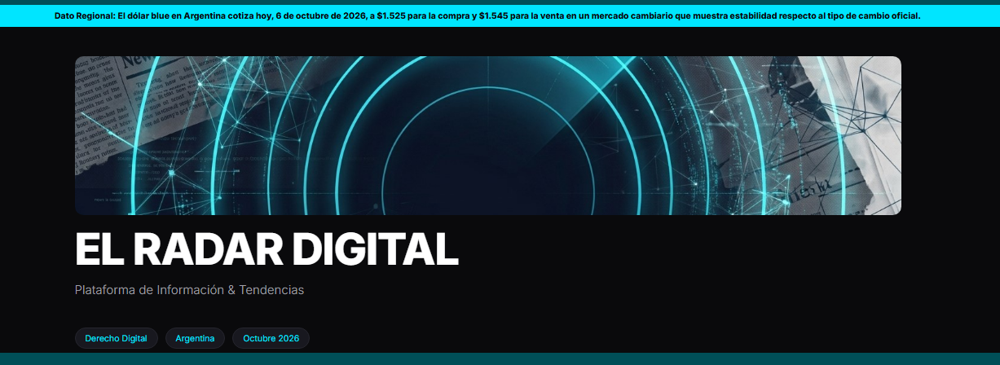
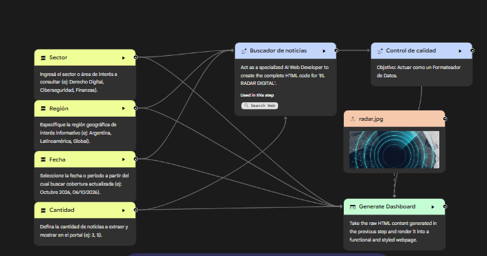

# 📡 El Radar Digital — Buscador de Noticias Automatizado con Opal

> **Agente de automatización de noticias desarrollado sobre Opal (Google AI Agent Engine).**  
> *Diseñado y optimizado por [Noelia Orsini](https://github.com/NoeliaOrsini).*

---

## 💡 Descripción del Proyecto

**El Radar Digital** es una aplicación interactiva desarrollada en la plataforma Opal durante la Inmersión de AI Agents. El objetivo principal es permitir al usuario buscar noticias filtradas por ubicación geográfica y cantidad deseada, garantizando enlaces 100% reales y una interfaz visual personalizada.

---

## 🛠️ Arquitectura de Nodos y Flujo de Trabajo

El sistema está estructurado mediante un flujo de trabajo multinodo (pipeline) optimizado para velocidad, precisión y bajo consumo de recursos:

### 1. Layer de Entradas / User Inputs (Nodos de Parametrización)
El flujo comienza con 4 nodos amarillos de entrada que recopilan las especificaciones del usuario para modularizar la consulta:
* **Nodo Sector:** Define el área o industria de interés a consultar (ej: *Derecho Digital, Ciberseguridad, Finanzas*).
* **Nodo Región:** Especifica el alcance geográfico de la búsqueda (ej: *Argentina, Latinoamérica, Global*).
* **Nodo Fecha:** Establece el período o fecha límite a partir de la cual rastrear noticias actualizadas (ej: *Octubre 2026*).
* **Nodo Cantidad:** Determina el límite exacto de noticias a extraer y renderizar en el portal (ej: *3, 5*).

### 2. Nodos de Procesamiento y Lógica
1. **Buscador de Noticias (Gemini Flash + Web Search):**  
   Recibe los 4 inputs del usuario y genera el contexto regional extrayendo las novedades relevantes mediante **Gemini Flash** por su baja latencia.
2. **Control de Calidad (Fiscalizador de Fuentes):**  
   Audita que las noticias extraídas cuenten con enlaces reales activos y sin errores, consultando el motor de búsqueda para evitar alucinaciones de URLs.
3. **Asset Estático (`radar.jpg`):**  
   *Decisión de diseño:* Se reemplazó el nodo de generación dinámica de imágenes por IA por un **asset estático predefinido**. Esto eliminó el cuello de botella en el procesamiento y evitó sobrecargas en hardware con 4 GB de RAM.
4. **Generate Dashboard (Renderizado HTML/CSS):**  
   Toma el contenido formateado y validado, lo cruza con las variables ingresadas y el asset gráfico, maquetando la salida en una interfaz gráfica en **Charcoal Dark Mode**.

---

## 📐 Decisiones de Ingeniería y Solución de Problemas (Troubleshooting)

* **Optimización de Hardware & Latencia:** En entornos de prueba/beta donde la generación multimedia por consulta ralentiza el flujo, el uso de un asset predefinido permitió mantener una ejecución rápida y estable.
* **Escalabilidad del Proceso:** La arquitectura ejecuta la validación y renderizado de forma secuencial/iterativa por cada noticia solicitada, asegurando control estricto de calidad en el output final.
* **Integración del Ecosistema Google:** Diseñado previendo la evolución de la plataforma, ya que Opal pasará a integrarse de forma nativa como una *skill* dentro del ecosistema Gemini (en paralelo con la evolución vista en Gemini Notebook).

---

## 🎨 Interfaz y Resultado de la Búsqueda

* **Estética:** Charcoal Dark Mode con acentos en contraste.
* **Branding:** Cabecera con firma de autoría integrada directamente en el maquetado.

---

## 🔗 Enlaces y Demo

* **App en vivo (Opal):** [Ver El Radar Digital en Opal](https://opal.google/app/1OZye3mq0NL0L9Az9PcDX43FoCIQkjK9Y)

---

## 📜 Licencia y Autoría

Desarrollado por **Noelia Orsini**  
*Back-end Developer & AI Automation*  
📍 Lobos, Buenos Aires, Argentina  

🌐 **Portfolio Web:** [noelia-orsini-portafolio.lovable.app](https://noelia-orsini-portafolio.lovable.app/)  
💼 **LinkedIn:** [linkedin.com/in/noelia-orsini](https://www.linkedin.com/in/noelia-orsini)  
🐙 **GitHub:** [github.com/NoeliaOrsini](https://github.com/NoeliaOrsini)